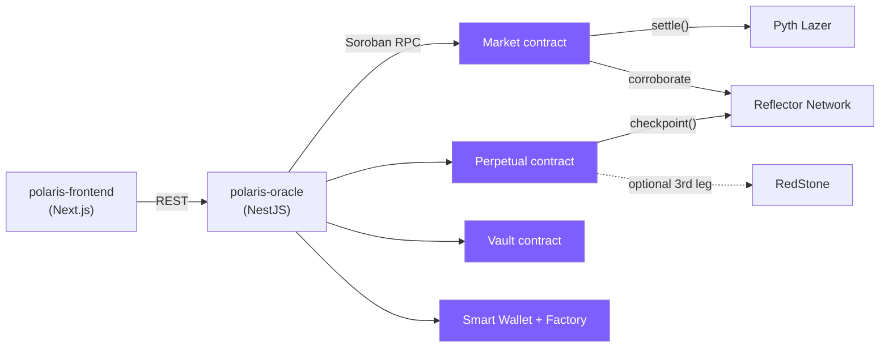

# polaris-contracts

[](https://github.com/PolarisQ-xyz/polaris-contracts/actions/workflows/ci.yml)
[](./LICENSE)
[](https://crates.io/crates/soroban-sdk)

Rust / Soroban smart contracts for **Polaris** — a fully-collateralized,
non-custodial prediction-market system on Stellar. Every position is backed
1:1 by real collateral at every instant; no market can ever owe more than it
holds. Settlement is verified on-chain against a signed Pyth Lazer price
update, cross-checked against a second, genuinely independent oracle
(Reflector Network) before any funds move.

This is one of three repos that make up Polaris:

| Repo | Role |
|---|---|
| **polaris-contracts** (this repo) | The on-chain rules: markets, perpetuals, the LP vault, passkey wallets |
| [polaris-oracle](https://github.com/PolarisQ-xyz/polaris-oracle) | NestJS backend — settlement automation, multi-oracle price relay, sponsored transactions, admin API |
| [polaris-frontend](https://github.com/PolarisQ-xyz/polaris-frontend) | Next.js web app — trading UI, portfolio, embeddable widget, admin dashboard |

## Live on testnet

| Contract | Address |
|---|---|
| Capital-efficiency vault | [`CDAZVYBSONMRKSXILQGYWIMDHIAWNWISBOEEPU6EG7RUBJPGHP6VZZBW`](https://stellar.expert/explorer/testnet/contract/CDAZVYBSONMRKSXILQGYWIMDHIAWNWISBOEEPU6EG7RUBJPGHP6VZZBW) (redeployed — see `polaris-oracle`'s README, bug 16, and [docs/redeploy-vs-patch.md](./docs/redeploy-vs-patch.md) for why the original instance was abandoned rather than reused) |
| Smart-wallet factory | [`CCBVJYZWNEOQTY6KVCPZ2G6YJ7QTBPUEO6IE6YT7J2QZDQW2Q5Z43VQY`](https://stellar.expert/explorer/testnet/contract/CCBVJYZWNEOQTY6KVCPZ2G6YJ7QTBPUEO6IE6YT7J2QZDQW2Q5Z43VQY) (redeployed — see the smart-wallet section's "relying-party `origin`/`type` checks" below for why the prior instance's wallets run code with no origin binding and are unaffected, not reused) |
| Mock RedStone (testnet stand-in) | [`CAFAVGX6VUIRPK2KDCK7QGJEOOBM2EWCIA5UJBLOR2T7HZINKVKYRYTI`](https://stellar.expert/explorer/testnet/contract/CAFAVGX6VUIRPK2KDCK7QGJEOOBM2EWCIA5UJBLOR2T7HZINKVKYRYTI) |

Individual market/perpetual contracts are deployed on demand by
`polaris-oracle` (each market is its own contract instance) — the live
backend driving those deploys is at
[polaris-oracle-api.fly.dev](https://polaris-oracle-api.fly.dev), and the running
app is at
[polaris-frontend-iota.vercel.app](https://polaris-frontend-iota.vercel.app).

## Contents

- [Contracts at a glance](#contracts-at-a-glance)
- [Why not the original parimutuel design](#why-not-the-original-parimutuel-design)
- [Core mechanism](#core-mechanism)
- [The invariant that matters](#the-invariant-that-matters)
- [Cancellation payout](#cancellation-payout)
- [Pool-depth guard](#pool-depth-guard)
- [Errors, not panics](#errors-not-panics)
- [Cost-driven fee curve](#cost-driven-fee-curve)
- [Event schema](#event-schema)
- [Passkey smart wallets](#passkey-smart-wallets)
- [Wallet policy: what a passkey assertion authorizes](#wallet-policy-what-a-passkey-assertion-authorizes)
- [The capital-efficiency vault](#the-capital-efficiency-vault)
- [On-chain second-oracle: Reflector Network](#on-chain-second-oracle-reflector-network)
- [A second settlement path: settle_via_reflector](#a-second-settlement-path-settle_via_reflector)
- [A third oracle: RedStone](#a-third-oracle-redstone)
- [The perpetual contract](#the-perpetual-contract)
- [Engineering notes: soroban-sdk gotchas](#engineering-notes-soroban-sdk-gotchas)
- [Building & testing](#building--testing)
- [Deploying](#deploying)
- [Integrating: polaris-interface](#integrating-polaris-interface)
- [Contributing](#contributing)

## Architecture



The four highlighted boxes are this repo. Nothing in this workspace talks to
`polaris-oracle` or `polaris-frontend` directly — contracts only know about
each other and the oracle feeds they read.

## Contracts at a glance

Ten crates, one Cargo workspace:

| Crate | Purpose |
|---|---|
| `contracts/market` | The market contract. Source of truth for all funds and rules. `settle` requires a second, genuinely independent oracle (Reflector Network, optionally a third — RedStone) to agree with Pyth Lazer on-chain before finalizing. |
| `contracts/perpetual` | A no-expiry, no-leverage sibling to `contracts/market` — continuous trading with no forced terminal settlement. |
| `contracts/vault` | Capital-efficiency vault — centralizes LP custody and accounting for market seed liquidity, funded once per depositor rather than fragmented per market. |
| `contracts/smart-wallet` | A Soroban custom account contract authorized by a WebAuthn passkey (secp256r1) instead of a keypair. |
| `contracts/smart-wallet-factory` | Deploys + initializes a `smart-wallet` instance in one atomic call, at a deterministic address derived from the passkey's public key. Configured via `__constructor` at deploy time. |
| `contracts/ctf-math` | `rlib`-only shared crate (no `#[contract]`) holding the pure CTF/AMM math, the generic SEP-40 oracle client, and the oracle-corroboration logic both `market` and `perpetual` call. |
| `contracts/mock-lazer` | Testnet-only stand-in for the real `pyth-lazer-stellar` verifier. **Never deploy to mainnet.** |
| `contracts/mock-redstone` | Testnet-only stand-in for RedStone's real (mainnet-only) SEP-40 wrapper. **Never deploy to mainnet.** |
| `interface` | `polaris-interface`: the publishable crate of typed clients and contract types, generated from vendored release wasm. See [Integrating](#integrating-polaris-interface). |
| `tools/oracle-config` | `polaris-oracle-config`: a CLI that builds validated `OracleFeedConfig`/`PriceOracleConfig` JSON for `initialize`. See [Deploying](#deploying). |

## Why not the original parimutuel design

The obvious design for a binary market is parimutuel: everyone stakes into a
shared pool, the losing side's stakes fund the winners, split pro-rata at
settlement. That's simple, but it has two structural weaknesses:

1. **No price discovery before expiry.** A stake is frozen the moment it's
   placed; there's no live "odds" and no way to exit early.
2. **An edge case to special-case.** If literally nobody bet the winning
   side, there's nothing to pay winners with — you need a bespoke "empty
   winning pool → refund everyone" branch.

Polaris instead uses a **fully-collateralized conditional-token market**
(the design behind Gnosis's Conditional Tokens Framework and Polymarket),
with a **constant-product AMM** (Uniswap-style `x*y=k`, not LMSR — LMSR needs
floating-point `exp`/`ln`, which isn't safe to hand-roll in an integer-only
WASM contract) for continuous pricing between the two outcome shares.

## Core mechanism

- **`split(amount)`** locks `amount` collateral, mints `amount` YES-shares
  **and** `amount` NO-shares to the caller. Always 1:1, always fully
  collateralized — this can never be gamed or under-collateralized.
- **`merge(amount)`** is the inverse: burn equal YES+NO, get `amount`
  collateral back. Available any time before resolution.
- **`buy(prediction, collateral_amount)`** = split, then swap the unwanted
  side into more of the wanted side via the AMM. One call, standard "buy
  YES" UX; returns more shares than a plain split because of the swap bonus.
- **`sell(prediction, shares_in)`** sells directly to collateral in one
  call, using a closed-form solve of the constant-product invariant (see
  the doc comment on `cpmm_sell_out` in `contracts/market/src/lib.rs` for
  why a naive "swap to the other side, then merge" silently returns zero
  when a user sells an entire one-sided position — a bug this build's test
  suite catches and asserts against by name).
- **`transfer(from, to, prediction, amount)`** moves a share balance between
  addresses — the tradability primitive. Shares are internal ledger entries
  on the market contract itself, not a separate SEP-41 token contract per
  side.
- **`settle(payload)`** — permissionless once expiry has passed. Verifies
  the Pyth Lazer payload on-chain via `pyth-lazer-stellar-sdk`, reads the
  configured feed, checks the price is timestamped within ±5 minutes of
  expiry, and marks the winning side (`>=` strike → YES, inclusive).
- **`settle_via_reflector()`** — a second, payload-free settlement path for
  when no Lazer access is configured at all; see
  [A second settlement path](#a-second-settlement-path-settle_via_reflector)
  below.
- **`cancel()`** — the liveness backstop. Permissionless once
  `expiry + grace_period` has passed with no settlement. Every holder can
  then redeem — see [Cancellation payout](#cancellation-payout) for why
  it's *not* 1:1 on both sides.
- **`redeem(user)`** — pays out 1:1 collateral per winning share once
  resolved; on cancellation, 0.5 collateral per share held on either side.

## The invariant that matters

Because every share is minted as a matched YES+NO pair against locked
collateral, and every code path that changes a real collateral balance
changes `total_supply` by the exact same amount, this holds after **every
single successful call**, for the whole lifecycle:

```
collateral_token.balance(market_contract) == market.total_supply
```

The market can never be short of collateral to pay whoever's holding the
winning side — there's no "empty winning pool" branch to write or test,
because the invariant makes it structurally impossible. `assert_solvent()`
in the test suite checks this after every test.

## Cancellation payout

`redeem()` on a cancelled market pays **0.5 collateral per share held on
either side** (`(balance_yes + balance_no) / 2`), not 1:1 on both — and
that 0.5 isn't a compromise, it's load-bearing.

`sum(all YES balances) == total_supply` and `sum(all NO balances) ==
total_supply` are both independently true (the same number) — but real
collateral only ever backs *one* `total_supply`'s worth, not two.
`settle()`'s resolved paths get this right by paying only the winning side
and discarding the other. `cancel()` has no winning side, so an earlier
version paid *both* in full — which double-counts against a single pool of
backing collateral.

Caught live, not in review: a single user who did nothing but `split()` a
plain matched pair (no AMM, no `buy`/`sell` involved at all) — cancel,
redeem — got back double what they'd locked. The treasury's own,
completely ordinary redemption of its pool-seeded share then panicked:
`"balance is not sufficient to spend"`. Existing tests only ever redeemed
one holder per test and stopped, so nobody had checked whether the *next*
legitimate holder could still get paid. See
`cancel_redeem_stays_solvent_for_every_holder_including_treasury` in
`contracts/market/src/test.rs`.

Paying each complementary token 0.5 is the standard answer for a voided
market in CTF-style systems generally (Polymarket, Gnosis), for exactly
this reason: it's the only per-holder formula that's *guaranteed* solvent
— summed across every holder, payouts equal `total_supply` exactly,
regardless of trading history — without tracking anything beyond the
balances that already exist.

**Zero trades ever, then cancelled: the seed liquidity is fully
recoverable, at par, by `treasury` alone.** A market that was only
`initialize()`d — no `split`/`buy` from anyone — still holds its untouched
AMM pool of `initial_liquidity` YES + `initial_liquidity` NO. `cancel()`
credits that whole pool to `treasury` as an ordinary share position (the
same thing `settle()` does with the pool), so `treasury`'s `redeem()` pays
`(L + L) / 2 = L` — exactly the seed it put in, with no special case in the
code. Nobody else holds a share, so nobody else can redeem
(`NothingToRedeem`), and afterwards the market holds zero collateral and
`total_supply == 0`. When `treasury` is the vault, the same recovery is one
`redeem_from_market` call. ([#52](https://github.com/PolarisQ-xyz/polaris-contracts/issues/52),
tests: `cancel_with_zero_trades_ever_returns_the_full_seed_liquidity_to_treasury`
in `contracts/market`,
`redeem_from_market_recovers_the_full_seed_after_a_zero_trade_cancel` in
`contracts/vault`.)

## Pool-depth guard

`buy`/`sell` reject a trade outright (`Error::PoolDepthExceeded`) if it
would consume half or more of the reserve it's drawing from. This isn't
slippage protection — `min_shares_out`/`min_collateral_out` already cover
that. It's a correctness fix for integer floor division: `cpmm_out`'s
`k / new_reserve_in` can floor hard enough that a large-but-entirely-plausible
trade against a shallow pool claims nearly the *entire* opposite reserve.
Confirmed empirically: a single 10.1 XLM buy against a 10,000-stroop seeded
pool drained it from 10,000 down to 1 before this guard existed (see
`buy_large_enough_to_exhaust_a_reserve_is_rejected` in
`contracts/market/src/test.rs`).

## Errors, not panics

Every entrypoint returns `Result<T, Error>` with a typed `#[contracterror]`
enum rather than trapping. A failed call still reverts the whole
transaction — atomicity isn't lost — but callers get a structured reason
instead of an opaque panic.

Errors cross the wasm boundary as bare `u32` codes, so a caller without
the source sees only a number and a variant name. The name alone has to say
which condition fired. Two pairs in `contracts/market` used to read as
synonyms. They were renamed in
[#58](https://github.com/PolarisQ-xyz/polaris-contracts/issues/58):

| Code | Old name | New name | Fires when |
|---|---|---|---|
| 9 | `MarketNotOpen` | `MarketSettledOrCancelled` | `status` is `ResolvedYes`/`ResolvedNo`/`Cancelled` |
| 10 | `TradingClosed` | `MarketExpiredAwaitingSettlement` | `buy`/`sell` past `expiry`, `status` still `Open` |
| 26 | `ReflectorDecimalsInvalid` | `ReflectorDecimalsOutOfRange` | live `decimals()` outside `2..=30` (init or settle) |
| 29 | `ReflectorDecimalsChanged` | `ReflectorDecimalsDriftedSinceInit` | live `decimals()` differs from the value pinned at init |
| 32 | `RedstoneDecimalsInvalid` | `RedstoneDecimalsOutOfRange` | as 26, RedStone leg |
| 33 | `RedstoneDecimalsChanged` | `RedstoneDecimalsDriftedSinceInit` | as 29, RedStone leg |

**Breaking change to the error ABI (names, not codes).** Every code is
unchanged (`renamed_error_variants_keep_their_wire_codes` pins them), so a
deployed instance and anything matching on numbers is unaffected. The
contract spec's variant names did change, so generated bindings (Rust via
`polaris-interface`, TypeScript via `stellar contract bindings`) and any
client matching on the old names must be regenerated or updated. That makes
the next `polaris-interface` release a minor-version bump (0.2.0). See
`interface/README.md`. `contracts/perpetual` has the same two decimals
pairs under its own codes and is not renamed here.

## Emergency pause

Neither `market` nor `perpetual` used to have any way to stop trading
faster than natural expiry (classic market) or a full, irreversible
`terminate()` (perpetual) — so a critical bug in the shared
`cpmm_out`/`cpmm_sell_out`/`apply_fee` math on an already-live market had
no faster mitigation than waiting it out. Fixed with an admin-gated
`pause()`/`unpause()` pair on both contracts, scoped narrowly to `buy`/
`sell` specifically — the two entrypoints whose correctness actually
depends on that shared AMM math. `split`/`merge` stay available while
paused (fixed 1:1 collateral↔share pairs, not AMM-priced, so a pricing bug
can't reach them), and `redeem` is *never* blocked by a pause — funds
already resolved/cancelled/terminated can never be frozen by this switch.
Independent of `status`/`PerpetualStatus`: pausing doesn't change whether
a market is `Open`, it just gates the two riskiest entrypoints within that
state.
([#8](https://github.com/PolarisQ-xyz/polaris-contracts/issues/8), tests:
`pause_blocks_buy_and_sell_but_not_split_merge_or_redeem`,
`pause_requires_admin_auth`, `redeem_still_works_while_paused`, in both
`contracts/market/src/test.rs` and `contracts/perpetual/src/test.rs`.)

The vault has its own, separate switch: `pause_deposits(admin)` /
`unpause_deposits(admin)` halt `deposit` only, for a migration or
admin-rotation window when new capital shouldn't land in an instance about
to be retired. `withdraw`, `redeem_from_market`, and admin rotation keep
working, so the admin can still move funds out while deposits are halted.
The flag is stored under its own key (a missing key reads as "not paused",
so existing instances need no migration), and it survives an admin rotation:
only the *current* admin can lift it.
([#41](https://github.com/PolarisQ-xyz/polaris-contracts/issues/41), tests:
`pause_deposits_blocks_deposit_but_not_withdraw`,
`pause_and_unpause_deposits_require_the_admin`,
`deposit_pause_survives_admin_rotation_and_only_the_new_admin_can_lift_it`.)

## Instance-storage TTL

`market` and `perpetual` have always called `extend_ttl` on every write —
but `vault`, `smart-wallet`, `smart-wallet-factory`, `mock-redstone`, and
`mock-lazer` never did, despite all five writing to (or, for `mock-lazer`,
simply owning) instance storage. Soroban archives an entry once its TTL
lapses; the next call touching it fails until someone submits a
`RestoreFootprintOp`. Market/perpetual are low-risk in practice (every
`buy`/`sell` bumps TTL as a side effect of ordinary usage) — the vault
specifically holds real pooled capital and can go long stretches between
`deposit`/`withdraw` calls, and a low-traffic `smart-wallet-factory` could
see long gaps between any two signups. All five now call the same
`extend_ttl(BUMP_THRESHOLD, BUMP_TO)` pattern market/perpetual already
established, on every entrypoint that touches instance storage (or, for
`smart-wallet`'s `__check_auth` and `smart-wallet-factory`'s `deploy`,
on every successful *use* of the contract, not just its one-time setup
call — a dormant wallet/factory needs the TTL refreshed by something other
than a setup call that only ever runs once).
([#11](https://github.com/PolarisQ-xyz/polaris-contracts/issues/11).)

## Cost-driven fee curve

The swap fee isn't a flat admin-set constant — it's computed per-trade from
a curve: `effective_fee_bps = min_fee_bps + (base_fee_bps - min_fee_bps) *
initial_liquidity / total_supply`. A fresh market charges `base_fee_bps`;
as `total_supply` grows (more collateral locked via `split`/`buy`), the fee
compresses toward `min_fee_bps` automatically. Query the current value with
`get_fee()` rather than recomputing it elsewhere.

**Adjusting a live curve is decrease-only.** `set_fee_curve(base_fee_bps,
min_fee_bps)` (admin-gated, `market` and `perpetual`, `Open` only) can
lower either bound, but rejects any increase with `FeeIncreaseNotAllowed`.
A freely adjustable fee would let an admin add a house edge after people
had already traded, which contradicts the "no house edge" framing. A
decrease-only change can't harm traders. With `r = initial_liquidity /
total_supply` in `(0, 1]`, the curve is `floor(base·r + min·(1−r))`, which
is non-decreasing in both bounds, so as long as neither bound rises, every
future trade at every `total_supply` is charged at most what the old curve
charged. The only cost of a reduction falls on the treasury, because fees
stay in the pool that is swept to it at settlement. Each change emits
`fee_set` with the old and new values. This matters more for `perpetual`,
which has no expiry, so "wait for it to resolve" never comes.
([#42](https://github.com/PolarisQ-xyz/polaris-contracts/issues/42), tests:
`set_fee_curve_rejects_any_increase_and_leaves_the_curve_untouched`,
`a_decrease_only_change_never_charges_more_at_any_total_supply`, which
brute-forces the monotonicity claim, floor rounding included, against the
shared curve.)

## Fee yield vs. price movement in the pool

Swap fees never leave the pool. They accrue into its depth and reach the
treasury at settlement. `get_market()`'s raw `pool_yes`/`pool_no` can't
separate that yield from the seed or from the pool simply going lopsided
as the price moves. `get_pool_growth()` (read-only, `Open` markets only,
nothing new stored) does:

| Field | Meaning |
|---|---|
| `initial_liquidity` | the seed |
| `invariant_liquidity` | `floor(sqrt(pool_yes · pool_no))`: depth with the price effect removed |
| `fee_growth` | `invariant_liquidity − initial_liquidity`: fee accrual |
| `pool_value` | pool shares marked at `get_price`'s odds, `floor(2·pool_yes·pool_no / (pool_yes + pool_no))` |
| `price_effect` | `pool_value − invariant_liquidity`, always `≤ 0`: the AMM's impermanent loss |

`pool_value == initial_liquidity + fee_growth + price_effect` holds exactly.
The split works because a fee-free constant-product swap leaves `k =
pool_yes · pool_no` unchanged, and only the fee grows it. Price movement
shows up only in `price_effect`, and it unwinds as odds return to 50/50.
`fee_growth` only grows. The one exception is integer rounding of about one
unit per trade, which can go either way, so it is visible only on a 0 bps
curve. Once a market settles or is cancelled, the reserves are swept to the
treasury and zeroed. The swept amounts are the treasury's credited YES/NO
shares (and are in the `cancel` event), so the same formulas give the final
breakdown.

It describes the whole pool, not a per-LP share. That's enough while the
treasury/vault is the only LP. Fractional LP shares
([#2](https://github.com/PolarisQ-xyz/polaris-contracts/issues/2)) would
divide these numbers by shares rather than replace them.
([#31](https://github.com/PolarisQ-xyz/polaris-contracts/issues/31), tests:
`pool_growth_separates_fee_accrual_from_price_movement`,
`fee_growth_accumulates_across_trades_while_the_price_effect_can_unwind`.)

## Event schema

Every event was audited against one question: could an indexer render a
correct trade-history page from events alone, with **zero** extra
`get_market()` reads? Before #39 the answer was no. `buy`/`sell` didn't say
what fee was charged or where the pools ended up, so a price chart needed
polling. `settle`/`cancel`/`terminate` silently credited the treasury with
the swept pool shares, and no event showed it. `redeem` zeroed both share
balances but reported only the payout.

The rule now: **every event that changes contract state carries the
post-call value of each field it changed**, plus anything (like the fee rate
actually charged) that a consumer would otherwise have to recompute with
protocol math. Topics are unchanged throughout. Data is a positional tuple
(`ScVec`).

| Contract | Topics | Data |
|---|---|---|
| market | `init` | `(strike_price, expiry, grace_period, feed_id, base_fee_bps, min_fee_bps, initial_liquidity, admin, treasury, collateral)` |
| perpetual | `init` | `(initial_liquidity, base_fee_bps, min_fee_bps, admin, treasury, collateral)` |
| both | `split, user` / `merge, user` | `(amount, total_supply)` |
| both | `buy, user, prediction` | `(collateral_in, bonus_shares, fee_bps, pool_yes, pool_no, total_supply)` — shares received = `collateral_in + bonus_shares` |
| both | `sell, user, prediction` | `(shares_in, collateral_out, fee_bps, pool_yes, pool_no, total_supply)` |
| both | `xfer, from, to, prediction` | `amount` (unchanged; no contract state besides the two balances) |
| market | `settle` | `(status, final_price_cents, source, treasury, swept_yes, swept_no)` — `source` is `lazer` or `reflector` |
| market | `cancel` | `(treasury, swept_yes, swept_no)` |
| perpetual | `term` | `(treasury, swept_yes, swept_no)` |
| perpetual | `chkpt` | `(price_cents, timestamp)` (unchanged; already complete) |
| both | `redeem, user` | `(payout, yes_burned, no_burned, total_supply)` |
| both | `fee_set` | `(old_base_bps, old_min_bps, new_base_bps, new_min_bps)` |
| both | `paused` / `unpaused` | `()` |
| vault | `init` | `(admin, collateral)` (new; `initialize` used to emit nothing) |
| vault | `deposit, from` | `(amount, total_deposited)` |
| vault | `dpaused` / `dunpaused` | `()` |
| vault | `withdraw, to` / `mkt_rdm, market` / `propose` / `newadmin` | unchanged |

`fee_bps` is the rate actually charged on that trade (the pre-trade value
of `get_fee()`). `pool_yes`/`pool_no`/`total_supply` are absolute
post-trade values, so the implied price after any trade is
`pool_no / (pool_yes + pool_no)` and an indexer can resync pool state from
any single trade event. Per-holder share balances are still
**delta-encoded** (each event says how a balance moved, not where it
ended), so they need a replay from `init`. Stellar RPC only serves events
for a bounded retention window, so an indexer that falls further behind
than that window has to bootstrap positions with `get_position()` reads.

**Compatibility.** Where the old payload was already a tuple (`buy`, `sell`,
market `init`, `settle`), the original fields keep their positions and the
new ones are appended. A positional decoder that only reads the leading
fields keeps working. Events whose data used to be a bare scalar or `()`
(`split`, `merge`, `redeem`, perpetual `init`, `cancel`, `term`, vault
`deposit`) are now tuples, which is a breaking change for any consumer that
decoded them as a bare `i128`. No indexer exists yet; this change should
land before `polaris-oracle`'s trade-history indexer work begins, not after.
([#39](https://github.com/PolarisQ-xyz/polaris-contracts/issues/39), tests:
`an_event_only_indexer_reconstructs_the_full_market_state_exactly`, which
folds only emitted events into a shadow ledger across a mixed
buy/sell/split/merge/transfer/settle/redeem flow and asserts it matches
`get_market()` and every holder's `get_position()` exactly, plus
per-event payload tests in all three contracts.)

## Passkey smart wallets

Rather than requiring a browser extension (Freighter) for every bettor,
`contracts/smart-wallet` lets a WebAuthn passkey (Face ID / Touch ID /
Windows Hello / a hardware key) act as the signer for a Soroban `Address`
directly, via Soroban's account-abstraction `__check_auth` mechanism.

The verification logic — challenge binding via base64url, the
`sha256(authenticator_data ‖ sha256(client_data_json))` digest construction —
is adapted from [leighmcculloch/soroban-webauthn](https://github.com/leighmcculloch/soroban-webauthn),
the reference pattern the Stellar ecosystem uses for this. That repo
explicitly calls its own code "demo material only... not audited"; the same
applies here. It's grounded in real, independently-verified cryptography
(the test suite generates and self-verifies a genuine secp256r1 keypair and
signature) but this has not had a professional security review and should
not hold real value.

One non-obvious thing the test suite caught empirically: Soroban's
`secp256r1_verify` **rejects high-S signatures**. A signature generated
without normalizing `s` to the curve's lower half verified fine locally
but was rejected by the Soroban host — the frontend's WebAuthn signing code
has to replicate this normalization (`s' = n - s` when `s > n/2`) on every
real browser assertion.

### Factory origin format

`initialize(admin, wasm_hash, origin)` pins the relying-party origin every
wallet this factory deploys will accept signatures from, so it must be a
bare scheme + authority: `https://host[:port]`, or `http://localhost[:port]`
for local development. No trailing slash, no path, no query/fragment, no
userinfo, no whitespace — anything else is rejected with `InvalidOrigin`,
because a malformed origin would be baked into every wallet the factory
ever deploys and permanently fail `__check_auth`'s byte-for-byte origin
comparison.

### Portable identity

Because a wallet's address is `deploy()`'s deterministic function of
`sha256(public_key)`, the *same* passkey resolves to the *same* Soroban
address regardless of which frontend calls the factory — `resolve(public_key)`
computes that address without deploying anything, so a caller can check
whether a wallet already exists before prompting a "create wallet" flow.

### Deploy events

Every successful `deploy(public_key)` emits a Soroban contract event from the
factory, giving an on-chain index of deployed wallets without any off-chain
bookkeeping:

- **Topics:** `(symbol_short!("deploy"), wallet_address)` — the deployed
  wallet's contract address.
- **Data:** the 65-byte uncompressed SEC1 `public_key` the wallet is bound to
  (the same value `resolve()` hashes, so an indexer can map key → address
  directly from the event).

A failed deploy (e.g. redeploying an existing key) emits nothing, since the
event is published only after the child contract's `init` call succeeds.

### Factory wasm pinning — a real, confirmed-exploitable bug that shipped fixed

`smart-wallet-factory`'s `deploy()` used to take `wasm_hash` as a caller-
supplied parameter, with no `require_auth()` either. A deployed wallet's
address is a pure deterministic function of `(this factory, sha256(public_key))`
— the exact formula `resolve()` exposes as a public, permissionless read for
anyone to compute in advance. An attacker who learned a victim's public key
before the *legitimate* deploy transaction landed (e.g. watching it sit in
the network's public mempool) could race a `deploy(victim_pk,
attacker_wasm_hash)` call ahead of it, permanently taking over the address
the whole system believes is the victim's wallet.

Reproduced directly (no real mempool race needed — the vulnerability is
that nothing stopped this at all, for any caller, for any already-uploaded
wasm): see `deploy_always_uses_the_pinned_wasm_never_a_caller_choice` in
`contracts/smart-wallet-factory/src/test.rs`.

Fixed by pinning the wasm hash once, at factory setup
(`__constructor(admin, wasm_hash, origin)`, admin-authenticated, run
atomically inside the deploy invocation — see #95) — `deploy`
now takes only `public_key` and always runs the pinned hash. `deploy`
itself stays deliberately unauthenticated: "anyone can pay to deploy
anyone's wallet" is the intended, safe design `polaris-oracle` relies on to
onboard a user who holds zero XLM — that's only ever safe once the code
being deployed can no longer be the caller's choice.

Verified live: deployed a fresh factory instance (constructor args passed
at deploy time), and
confirmed via the running `polaris-oracle` (a real email-login wallet
deploy) plus a direct on-chain `get_public_key` read that the deployed
wallet's stored key matches exactly what the backend generated.

### Relying-party `origin`/`type` checks — a missing WebAuthn verification step, found in a security review

`__check_auth` originally verified only two of the three things the
WebAuthn spec (§7.2) requires: the signature's cryptographic validity, and
`client_data_json.challenge` binding to the host-computed
`signature_payload`. It never checked `client_data_json.type` or `.origin`.

Those two checks exist for a specific reason the first two don't cover: a
signature proves *a* WebAuthn ceremony produced it, for *any* origin
sharing the wallet's `rpId` scope — not that the ceremony happened in a
context the wallet owner actually meant to authorize a transaction from. A
WebAuthn assertion silently requested from an untrusted page (a same-origin
XSS calling `navigator.credentials.get()` directly, bypassing the app's own
trade-confirmation UI entirely) would pass both original checks — the
browser's Face ID/Touch ID prompt gives no indication of *what* is being
authorized, so the victim approves what looks like an ordinary sign-in.
Without the `origin` check, that silently authorizes whatever transaction
the script asked for.

Fixed by storing an `origin` at `init()` time (alongside the public key,
same fixed-for-the-wallet's-lifetime treatment) and requiring
`client_data_json.type == "webauthn.get"` and `.origin == stored_origin` in
`__check_auth`. `origin` is pinned once at **factory** setup
(`initialize(admin, wasm_hash, origin)`), not a `deploy()`-time caller
parameter — `deploy` is deliberately unauthenticated, so a caller-chosen
origin would let anyone front-run a victim's own deploy call and
permanently brick their wallet with a wrong origin before they ever use
it, the same shape of bug this file already fixed once for `wasm_hash`
above, applied proactively here instead of waiting to find it the same
way.

Verified with real, independently-signed secp256r1 vectors (not
byte-edited forgeries — editing `client_data_json` after signing would
just invalidate the signature): `wrong_origin_rejected` inits a wallet
with one origin and presents a validly-signed assertion for a different
one; `wrong_ceremony_type_rejected` is a second, genuinely distinct signed
vector whose `type` is `"webauthn.create"` instead of `"webauthn.get"`. See
`contracts/smart-wallet/src/test.rs`.

Deployed as a fresh factory instance (existing wallets from the prior
factory keep running their original wasm, with no origin binding —
unaffected, same "redeploy rather than retrofit" pattern as the vault's
admin-rotation incident above; see [docs/redeploy-vs-patch.md](./docs/redeploy-vs-patch.md)) — the address listed under
[Live on testnet](#live-on-testnet).

## Factory generations and migration

A wallet's address is `deploy()`'s deterministic function of
`(this factory instance, sha256(public_key))` — see
[Portable identity](#portable-identity). That determinism is the feature, but
it has a sharp edge worth stating plainly: **a new factory instance is a new
generation, and every user's wallet address changes with it.** Redeploying
the factory (new contract ID, e.g. after a wasm upgrade, a new
relying-party `origin`, or a lost/rotated admin key) does not move, upgrade,
or invalidate any existing wallet — it simply means `resolve(public_key)`
against the *new* factory returns an address that has never been deployed,
while the user's funds and history still live at the *old* generation's
address. Nothing on-chain links the two; the mapping is the backend's job.

### What a generation is

| Generation | Factory contract ID | Pinned `wasm_hash` | Pinned `origin` |
|---|---|---|---|
| G1 | `C…` (first deployed) | wallet wasm v1 | `https://app.polaris.xyz` |
| G2 | `C…` (redeployed) | wallet wasm v2 | `https://app.polaris.xyz` |

`initialize(admin, wasm_hash, origin)` is one-time and there is no setter for
either value (see the decision below), so a generation's `(wasm_hash,
origin)` pair is immutable for that factory's whole life. Changing either
means deploying a new factory — a new generation — not editing the old one.

### Migration procedure

1. **Freeze the old generation.** Stop pointing new sign-ups at the old
   factory. Existing wallets keep working exactly as before — `deploy` is
   only ever called once per key, and `__check_auth` on an already-deployed
   wallet never consults the factory — so this is a routing change, not an
   on-chain one.
2. **Deploy and initialize the new factory** with the new `wasm_hash` and/or
   `origin`, and record its contract ID as the current generation in the
   backend's config (alongside the old IDs, never replacing them).
3. **Sweep old-wallet funds.** For each user with a balance at an old
   generation's address, the wallet itself must authorize the move — the
   factory has no authority over a deployed wallet, and neither does the
   admin. The passkey signs a transfer (or a `redeem`/`withdraw` from
   whatever contract holds the position) out of the old wallet to the new
   one, exactly as any other user transaction. Two practical consequences:
   - Sweeping is **user-driven or backend-prompted, never unilateral**. A
     user who never signs keeps their funds at the old address indefinitely;
     that is safe, just inconvenient, and must be surfaced in the UI rather
     than silently ignored.
   - Sweep *before* the old wallet's instance storage TTL lapses, or budget
     for a `RestoreFootprintOp` first (see
     [Instance-storage TTL](#instance-storage-ttl)).
4. **Resolve across generations in the backend.** `resolve(public_key)` is
   per-factory, so the backend must try generations newest-first and treat
   the first *deployed* address as the user's wallet:

   ```
   for factory in [current, ...older_generations]:   # newest first
       addr = simulate resolve(factory, public_key)
       if addr has code (deployed): return addr
   return None   # no wallet yet — deploy against `current`
   ```

   `resolve` is a free simulated read, so this costs nothing on-chain. The
   generation list is append-only config; never drop an old factory ID while
   any wallet at it still holds funds or history.
5. **Keep old generations readable forever.** Old factory instances stay
   deployed and initialized (their storage TTL is bumped on every `deploy`,
   but a dormant one needs an occasional `extend_ttl`/restore). They are
   never re-initialized, never re-pointed, and never treated as
   authoritative for new deploys.

### Decision: no admin-gated in-place updates to `wasm_hash`/`origin`

**Rejected.** `initialize` stays one-time and there is deliberately no
`set_wasm_hash`/`set_origin` entrypoint. Rationale:

- **`origin` is a security boundary, not a setting.** `__check_auth` binds
  every signature to the wallet's stored `origin` (see
  [Relying-party `origin`/`type` checks](#relying-party-origintype-checks--a-missing-webauthn-verification-step-found-in-a-security-review)).
  An admin who could re-point a live factory's `origin` could make every
  wallet it deploys accept assertions from a domain the admin controls —
  i.e. mint themselves signing authority over other people's wallets. That
  is a rug-pull primitive, and "the admin is trusted" is not a reason to
  build one into a non-custodial system.
- **`wasm_hash` is the same class of risk.** It is pinned precisely so that
  `deploy` — which is unauthenticated by design — can never be steered to
  attacker-chosen code (see
  [Factory wasm pinning](#factory-wasm-pinning--a-real-confirmed-exploitable-bug-that-shipped-fixed)).
  A mutable hash reintroduces that bug with an admin key as the only guard.
- **In-place updates would not even solve the stated problem.** Changing a
  factory's config does not move existing wallets: their addresses are
  already fixed, and their stored `origin` is baked into the wallet at
  `init`. A config change would only affect *future* deploys, producing a
  silent split where one factory ID serves two incompatible wallet
  generations — strictly worse for the backend than an explicit new
  factory ID.
- **A new generation is auditable and reversible.** A new factory ID is a
  visible, on-chain event; the old one keeps working; the backend's
  generation list makes the switch explicit. An in-place mutation is
  invisible to users and irreversible.

If a factory's config must change, deploy a new factory and follow the
migration procedure above. The only admin power over a factory is the
one-time `initialize`.

## Wallet policy: what a passkey assertion authorizes

`__check_auth` verifies *who* signed (the passkey, from the pinned origin,
over this transaction's payload) but not *what* the payload authorizes: the
`auth_contexts` argument is ignored, so one approved Face ID prompt can
authorize any invocation tree the host built — any contract, any function,
any amount. The threat (a malicious frontend or embedder), the candidate
policies (contract allowlist, native XLM spend cap), and how either would
interact with the factory-generation upgrade model are written up in
[`docs/issues/92-wallet-policy.md`](docs/issues/92-wallet-policy.md).
Implementation is a follow-up; nothing in this section is enforced on-chain
today.

## The capital-efficiency vault

`contracts/vault` is additive and isolated — **zero changes to
`contracts/market`**. What it fixes: every new market's `initial_liquidity`
used to be wired from the admin's own keypair by hand at `initialize()`
time, and that seed capital sat siloed in that one market's reserves for
its entire life, recovered only at settlement into a bare `treasury` wallet
address with no accounting at all. This is deliberately *not*
"cross-margin" in the derivatives sense (netting risk across positions, a
liquidation engine) — the vault centralizes *custody and accounting* of LP
capital while every individual market stays exactly as fully,
independently collateralized as it already was.

- `deposit(from, amount)` — LP capital in, permissionless.
- `withdraw(admin, to, amount)` — admin-gated capital out. Funds a new
  market's seed liquidity (what `polaris-oracle`'s `MarketFactoryService`
  draws on), or an LP redemption.
- `redeem_from_market(admin, market_id)` — collects the vault's own payout
  from a settled/cancelled market it was `treasury` for.
- `pause_deposits(admin)` / `unpause_deposits(admin)` — halt new deposits
  only, e.g. during a migration window; see [Emergency pause](#emergency-pause).

**v1 is deliberately simple, stated up front**: single-admin-owned capital,
not fractional LP shares. Multiple depositors can `deposit`, but there's no
proportional-withdrawal accounting yet — a real multi-LP product needs
share accounting before this is safe to open past a single trusted
operator ([tracked as an open issue](https://github.com/PolarisQ-xyz/polaris-contracts/issues/2)).
**A second, real consequence of v1's simplicity, now fixed**: `admin` used
to be set once at `initialize()` with no rotation function at all —
confirmed the hard way when a production signing-key rotation (see
`polaris-oracle`'s README, bug 16) permanently locked the first deployed
vault instance out of its own funds, with no way to recover access short
of abandoning it and deploying a fresh one. Fixed with a two-step
`propose_admin(current_admin, proposed)` / `accept_admin(proposed)` pair
(not a single-call `set_admin`): the proposed address must show up and
sign `accept_admin` with its own key before the rotation takes effect, so
a typo'd or unreachable address is harmless — just propose again — instead
of permanently bricking the vault the way the *missing* rotation already
did once. ([#4](https://github.com/PolarisQ-xyz/polaris-contracts/issues/4),
tests: `propose_then_accept_rotates_admin`,
`accept_admin_rejects_a_different_address_than_the_one_proposed`,
`a_bad_proposal_is_harmless_and_can_be_overwritten`.)

**Authority switches at `accept_admin`, not at `propose_admin`.** While a
rotation is pending, the current admin keeps full authority —
`withdraw`, `redeem_from_market`, and re-proposing all work exactly as
before — and the proposed address has none until it accepts. This is
deliberate: blocking the old admin as soon as a rotation is proposed would
freeze the vault whenever the proposed key never shows up, the same
lock-out two-step rotation exists to prevent.
([#53](https://github.com/PolarisQ-xyz/polaris-contracts/issues/53),
test: `old_admin_keeps_full_authority_while_a_rotation_is_pending`.)

Verified live on testnet, the full loop: deployed the vault above,
deposited 20,000,000 stroops, withdrew 10,000,000 of it to seed a real
market with the vault as `treasury`, settled that market, and called
`redeem_from_market` — a real transaction
(`401ddfea828d7050b367c9a9c8507ff509f0e5d3c6558a772b6bccf9b7d61fd0`,
confirmed `SUCCESS`) that moved exactly 10,000,000 stroops back from the
market to the vault, landing its balance back at the original 20,000,000.

## On-chain second-oracle: Reflector Network

`settle` no longer trusts Pyth Lazer's signed payload alone. It also reads
[Reflector Network](https://reflector.network) — genuinely independent
node operators and data pipeline — on-chain, via a real cross-contract
call, and requires the two to agree within `reflector.tolerance_bps`
before finalizing. This is enforced by the contract, not the backend: a
compromised or buggy `polaris-oracle` process can't bypass it.

Reflector publishes a free, [SEP-40](https://github.com/stellar/stellar-protocol/blob/master/ecosystem/sep-0040.md)-standardized
testnet oracle at `CCYOZJCOPG34LLQQ7N24YXBM7LL62R7ONMZ3G6WZAAYPB5OYKOMJRN63` —
`decimals()` is 14, `resolution()` is 300s (a 5-minute update cadence).

`OracleFeedConfig` (`initialize`'s 12th parameter for the Reflector leg,
required, not optional) bundles the corroborating-oracle settings into one
`contracttype` struct:

```rust
pub struct OracleFeedConfig {
    pub contract: Address,       // which oracle instance to read
    pub asset: Asset,            // Stellar(Address) or Other(Symbol)
    pub max_staleness_secs: u64, // validated at initialize() against the
                                  // oracle's own live resolution()
    pub tolerance_bps: u32,      // default 150 (1.5%); must be in
                                  // 1..=1000 (MAX_TOLERANCE_BPS) — see below
}
```

`tolerance_bps` is bounded at `initialize()` for **every** oracle leg, in
both `PolarisMarket` and `PolarisPerpetual`: it must be non-zero and at most
`MAX_TOLERANCE_BPS` (1000 bps = 10%). A value of 0 would reject every price,
and anything above 10% (in particular 10_000 bps or more) would accept any
divergence at all — silently disabling the corroboration check. Out-of-range
values are rejected with `InvalidReflectorConfig` (Reflector leg) or
`InvalidRedstoneConfig` (RedStone leg).

**Fails closed, not gracefully-degrades**: `None`/stale/divergent Reflector
data all reject `settle` outright. This doesn't strand funds — the existing
permissionless `cancel` after `expiry + grace_period` is already the
unconditional liveness backstop, so a market that can never get Reflector
agreement cancels and refunds through the exact same well-tested path
every other unresolvable market already uses.

## A second settlement path: `settle_via_reflector`

`settle(payload)` requires a cryptographically-signed Pyth Lazer payload —
real, but Pyth's public Lazer access moved behind a paid subscription
(Starter tier, $500/month minimum) after this project was first built,
making it unavailable to a deployment that can't pay for it.
`settle_via_reflector()` is a second, independent entrypoint added for
exactly that case: no payload, no signature to verify — it reads
Reflector's live on-chain price directly as the reference price instead of
merely corroborating against it. Same preconditions as `settle` (status
`Open`, `now >= expiry`), same fail-closed discipline (stale/unavailable
Reflector data, or a disagreeing RedStone leg if one is configured, both
reject outright), same payout mechanics — the two paths share a private
`finalize_settlement` helper so there's exactly one place that logic lives.

**Deliberately a separate function, not a parameter on `settle` itself**:
the two paths verify genuinely different things (a cryptographic signature
vs. a live contract read), and collapsing them into one entrypoint with a
branch would make it easy to silently accept whichever path is convenient
rather than whichever was actually intended by the caller.

This is not a downgrade dressed up as equivalent — Reflector was already
the mandatory, equally-trusted corroborating leg every `settle()` call has
always required; this just promotes it to primary reference price when no
Lazer payload exists at all. `polaris-oracle`'s `MarketService.trySettle`
tries this path first whenever no `PYTH_LAZER_TOKEN` is configured, only
falling through to the permissionless `cancel` liveness backstop if
Reflector itself is also unavailable/stale/divergent, or the market was
deployed from a wasm older than this function's existence.

**Timestamp bound**: like `settle`, the Reflector price must be timestamped
within `PRICE_FRESHNESS_WINDOW_SECS` (300s) of `expiry` on *both* sides —
`price.timestamp + 300 < expiry` rejects with `StalePrice`, and
`price.timestamp > expiry + 300` rejects with `FuturePrice`. Without the
upper bound a caller could settle on any post-expiry print during the grace
window, so the two paths enforce the same window.

## A third oracle: RedStone

`settle`/`record_price_checkpoint` can optionally corroborate against a
**third**, genuinely independent SEP-40 source — RedStone — on top of
Reflector, closing the gap between "2-of-2" and real multi-provider
redundancy.

- **Unanimous, not majority.** A market configured with a `redstone` leg
  requires *every* configured oracle to agree — any one disagreeing or
  unavailable rejects the call. Deliberate: Polymarket's UMA optimistic
  oracle had an $85M dispute gamed via permissionless quorum voting, and
  UMA's fix was to *restrict* its voter set rather than broaden it. A
  2-of-3 majority would mean an adversary only needs to control the same
  two sources as today's 2-of-2 — unanimous agreement is the only rule
  where a genuinely independent third source actually raises the bar.
- **RedStone's Stellar deployment is mainnet-only** — confirmed live:
  reading RedStone's real mainnet contract
  (`CBMGLKUQZVSAIL5CPDDAWSUY7MAKXISHMOZEVLMBUWBMFGHRJSR4WYRF`) returned a
  genuinely fresh XLM/USD price. No testnet contract exists, so
  `contracts/market`'s `redstone` parameter is `Option<OracleFeedConfig>`
  rather than required. `contracts/perpetual`'s checkpoint feature was
  already opt-in as a whole bundle, so `redstone` is a *required* field of
  `PriceOracleConfig` whenever that bundle is configured at all.
- **`contracts/mock-redstone`** is a bare SEP-40-shaped, admin-poked
  testnet stand-in (deployed at
  [`CAFAVGX6VUIRPK2KDCK7QGJEOOBM2EWCIA5UJBLOR2T7HZINKVKYRYTI`](https://stellar.expert/explorer/testnet/contract/CAFAVGX6VUIRPK2KDCK7QGJEOOBM2EWCIA5UJBLOR2T7HZINKVKYRYTI)),
  wired into `polaris-oracle`'s perpetual deployment alongside the real
  Reflector testnet oracle — this makes `record_price_checkpoint`
  genuinely exercisable end-to-end on testnet, not just unit-tested
  against a mock in isolation. Its prices are keyed by `Asset`
  (`set_price(asset, price, ts)`), so a config pointing at the wrong asset
  gets `None` — and therefore a `*PriceUnavailable` error — rather than
  another asset's price.

## The perpetual contract

`contracts/perpetual` started as a request for crypto-perpetual-futures
mechanics — margin, leverage, funding payments against a reference price.
That design was rejected in two stages before any code was written:

1. A paper (arXiv 2605.10400, "Resolution-Aware Perpetual Futures on
   Binary Prediction Markets") proves that any leverage `L > 1` applied to
   a binary 0/1-payout claim creates a *structural, guaranteed* insolvency
   mode on the adverse outcome. So: no margin, no leverage, ever — every
   position is fully collateralized 1:1 at every instant, identical in
   spirit to `contracts/market`'s own invariant.
2. A fully-collateralized attempt at "funding" (transferring a bounded
   fraction of the losing side's AMM pool to the winning side's pool each
   period) was designed, then found — by adversarial review, with a
   concrete numeric counterexample — to break the actual conservation
   invariant this codebase depends on everywhere else. Dropped rather than
   shipped half-trusted.

**What shipped instead**: no fixed expiry, and continuous exit liquidity
via the same already-audited `buy`/`sell` mechanics as `contracts/market`
— a holder never waits for a terminal event to realize a price move, they
just `sell()` at the current AMM-implied price, any time.

- `initialize` takes no `strike_price`/`expiry`/`grace_period` — `status`
  starts `Open` and, under normal operation, never leaves it.
- `record_price_checkpoint(payload)` is permissionless and reuses the
  exact dual/triple-oracle verification `settle` uses, but has **zero
  economic effect** — it only records `last_price_cents`/`last_price_at`
  for observability.
- `terminate(admin)` is the admin-gated wind-down safety valve — v1 scope,
  same convention as the vault's own "not fractional LP shares yet." A
  perpetual has no strike price, so `terminate` reuses `contracts/market`'s
  already-audited `Cancelled`-redemption treatment: every complementary
  YES+NO pair is worth 0.5 collateral each, the only per-holder formula
  guaranteed solvent regardless of trading history.

The whole path — `initialize` (with Lazer + Reflector + RedStone
configured) → `buy` on both sides → `record_price_checkpoint` → `terminate`
→ `redeem` for every holder, treasury included — is also exercised as one
chained test with the solvency invariant asserted after every step
(`full_lifecycle_initialize_buy_checkpoint_terminate_redeem_stays_solvent_throughout`,
[#54](https://github.com/PolarisQ-xyz/polaris-contracts/issues/54)).

## Engineering notes: soroban-sdk gotchas

<details>
<summary>Two non-obvious soroban-sdk 26.1 traps hit while building this, worth knowing if you extend these contracts</summary>

**`Option<CustomStruct>` as a `#[contracttype]` field fails, but only under
`cargo test`.** The natural first draft stored the optional oracle config
as a `price_oracle: Option<PriceOracleConfig>` field directly on the
contract's main struct. That fails to compile — but only under `cargo
test`, not a plain release build, which made it briefly confusing. Reason:
soroban-sdk's `#[contracttype]` macro generates each struct field's XDR
conversion via a fallible `TryFrom`, but `Option<T>`'s only route to
`ScVal` is a blanket `From<Option<T>>` impl requiring an *infallible* `T:
Into<ScVal>` — which a custom struct's generated (fallible) conversion
never satisfies. That codegen path is gated behind soroban-sdk's
`testutils` feature, which `cargo test` always enables via Cargo's feature
unification. Fix: store the optional config under its own separate
instance-storage key instead (`DataKey::PriceOracle`) — storage's `get()`
returns `Option<T>` through the always-supported `Val`-level conversion,
sidestepping the struct-field path entirely.

**`#[contracttype(export = false)]` can hide a type from every non-Rust
caller, silently.** `sep40::Asset` was declared `export = false` from when
it only ever described an *external* contract's call shape (Reflector's
`lastprice`). Once `Asset` became a genuine field of `OracleFeedConfig` (an
`initialize` parameter), that stopped being safe — but the compiled wasm
still had no resolvable spec entry for it. Confirmed live: both the
`stellar` CLI's JSON arg parser and `@stellar/stellar-sdk`'s
`contract.Spec` reject a value for that field with `Missing Entry Asset`,
even given the exact correct shape. This only broke *non-Rust* callers
(CLI, TypeScript SDK) of an otherwise-fully-working contract — silently,
until something outside this repository tried to construct the value from
JSON. Fix: plain `#[contracttype]` (dropped `export = false`). Rule of
thumb: `export = false` is only safe for a type that will *never* need to
be constructed from outside Rust source.

</details>

## Feed ID

`feed_id` is a required `initialize` parameter, with no default in the
contract. Testnet deploys use a placeholder (`100`). That placeholder is
also `polaris-oracle`'s `XLM_USD_FEED_ID`/`FEED_CATALOG` env default, which
is why it's a mainnet blocker there (see
[`docs/mainnet-env-audit.md`](./docs/mainnet-env-audit.md)). Before going
live, production deployment must look up Pyth's actual registered Lazer
feed ID for XLM/USD.

## Building & testing

Build and test with [`just`](https://github.com/casey/just) — the recipes
encode the required build order once, and CI runs the same targets:

```sh
just test        # build the wasm in order, then `cargo test --workspace`
just build-wasm  # release WASM only (requires `rustup target add wasm32v1-none`)
just hashes      # sha256 of the release WASM artifacts
just ci          # everything CI runs: test, diagnostic build, hashes
```

The order matters: `polaris-market` is built first, on its own, because
`polaris-vault`'s `contractimport!` reads its compiled wasm as a file at
build time — a dependency Cargo's own graph doesn't know about (see "The
capital-efficiency vault" above). That's why `cargo test --workspace` alone
fails on a fresh clone; use `just test`.

### Diagnostic builds (`release-with-logs`)

`Cargo.toml` also defines a `release-with-logs` profile: it inherits
`release` but turns on `debug-assertions`, so contract panics and
`assert!`/`debug_assert!` failures carry their messages instead of being
stripped. Use it **only for diagnostic testnet deploys — never for mainnet**:
the extra checks cost CPU instructions and the artifacts are not the ones
whose hashes are recorded above.

```sh
# diagnostic WASM for testnet debugging (same ordering rule as above)
just build-wasm-logs
# artifacts land in target/wasm32v1-none/release-with-logs/
```

CI builds this profile on every push/PR so it cannot silently break.

| Crate | Unit tests |
|---|---|
| `polaris-market` | 52 |
| `polaris-perpetual` | 25 |
| `polaris-smart-wallet` | 11 |
| `polaris-oracle-config` | 11 |
| `polaris-smart-wallet-factory` | 9 |
| `polaris-vault` | 13 |
| `polaris-mock-redstone` | 3 |
| `polaris-mock-lazer` | 1 |
| **Total** | **114** |

Current build (regenerate after any contract change — `polaris-oracle`'s
`MARKET_WASM_HASH`/`PERPETUAL_WASM_HASH` must track whatever hash is
actually uploaded):

| Contract | Size | SHA-256 |
|---|---|---|
| `polaris_market.wasm` | 63,067 bytes | `8b9affbb95c698dd26b7a981797bb80c0298219066de26b5c526fc03422ad068` |
| `polaris_perpetual.wasm` | 60,343 bytes | `37dee64443ac6b312ebb006433ebf0fa8590e925ab667a236cdb7ce0bd5b72d3` |
| `polaris_mock_lazer.wasm` | 855 bytes | `c0848b74e840eece46de06e424ea99e75467ed3ce80b36e4f9c975395978ce40` |
| `polaris_mock_redstone.wasm` | 7,465 bytes | `8c77fc03cf73ba92c3df188b73b9c54357358041c0ccc20701c91d1a198ef2ee` |
| `polaris_smart_wallet.wasm` | 28,307 bytes | `438833c472524aa6b91d50451fc8b9267a9aea74f64e6e3a00cad0ff7d859986` |
| `polaris_smart_wallet_factory.wasm` | 7,768 bytes | `c72006a7c649cacc291fba664ff6f31f3649c1f74c3756e7beccdf2877e13523` |
| `polaris_vault.wasm` | 18,579 bytes | `c2968db2b7b53114193571d9f1dfdd7bedd837f135cb57b407e97f7e039916d6` |

Built with rustc 1.95.0. These match `interface/wasm/SHA256SUMS` for the
five contracts `polaris-interface` vendors.

## CPU & memory budget

Settlement (`market::settle`, `market::settle_via_reflector`) and the
perpetual's `record_price_checkpoint` each read all three oracle legs
(Lazer payload, Reflector, RedStone). Regression tests pin their measured
cost below **70% of Stellar mainnet's per-transaction limits** so a future
change can't quietly push them toward the ceiling:

| Entrypoint | Test | CPU instructions | Memory (bytes) |
|---|---|---|---|
| `market::settle` | `settle_with_all_three_oracle_legs_stays_within_budget` | measured by the test (`std::println!`) | measured by the test |
| `market::settle_via_reflector` | `settle_via_reflector_with_all_three_oracle_legs_stays_within_budget` | measured by the test | measured by the test |
| `perpetual::record_price_checkpoint` | `checkpoint_with_all_three_oracle_legs_stays_within_budget` | measured by the test | measured by the test |

Network limits (Stellar mainnet, per transaction) and the asserted ceilings:

| Resource | Mainnet limit | Asserted ceiling (70%) |
|---|---|---|
| CPU instructions | 100,000,000 | 70,000,000 |
| Memory | 40 MB (41,943,040 bytes) | 28,000,000 bytes |

Each test calls `env.cost_estimate().budget().reset_unlimited()` immediately
before the entrypoint, then asserts `cpu_instruction_cost()` and
`memory_bytes_cost()` stay under the ceilings above. Run
`cargo test --workspace -- --nocapture` to print the measured numbers.

## Deploying

Needs the [Stellar CLI](https://developers.stellar.org/docs/tools/cli/install-cli).

`polaris-smart-wallet-factory` and `polaris-vault` take their setup
arguments through a Soroban `__constructor` (#95), so they are configured
atomically in the deploy transaction itself — there is no separate
`initialize` call, and no window in which an unconfigured instance exists
for someone else to initialize first:

```sh
stellar contract deploy --wasm target/wasm32v1-none/release/polaris_smart_wallet_factory.wasm \
  --source deployer --network testnet -- \
  --admin <ADMIN> --wasm_hash <SMART_WALLET_WASM_HASH> --origin <ORIGIN>

stellar contract deploy --wasm target/wasm32v1-none/release/polaris_vault.wasm \
  --source deployer --network testnet -- \
  --admin <ADMIN> --collateral <XLM_SAC>
```

`polaris-market` and `polaris-perpetual` still use a separate
`initialize` call (their setup reads oracle state and is invoked by
`polaris-oracle` right after deploy); moving them to `__constructor` is
tracked as a coordinated change with that repo:

```sh
stellar contract deploy --wasm target/wasm32v1-none/release/polaris_market.wasm \
  --source deployer --network testnet
stellar contract invoke --id <CONTRACT_ID> --source deployer --network testnet -- \
  initialize --admin <ADMIN> --collateral <XLM_SAC> --strike_price 1500000 \
  --expiry <UNIX_TS> --grace_period 3600 --lazer_contract <LAZER_OR_MOCK_LAZER_ID> \
  --feed_id 100 --base_fee_bps 100 --min_fee_bps 20 \
  --treasury <TREASURY> --initial_liquidity 10000000000 \
  --reflector '{"contract":"CCYOZJCOPG34LLQQ7N24YXBM7LL62R7ONMZ3G6WZAAYPB5OYKOMJRN63","asset":{"Other":"XLM"},"max_staleness_secs":600,"tolerance_bps":150}' \
  --redstone null
# Testnet only: feed_id 100 is an unverified placeholder, CCYOZ… is
# Reflector's *testnet* oracle, and no RedStone contract exists on testnet.
```

**Mainnet.** Every `<…>` must be looked up for mainnet. None of the
testnet values above carry over:

```sh
stellar contract deploy --wasm target/wasm32v1-none/release/polaris_market.wasm \
  --source deployer --network mainnet
stellar contract invoke --id <CONTRACT_ID> --source deployer --network mainnet -- \
  initialize --admin <ADMIN> --collateral <MAINNET_NATIVE_XLM_SAC> --strike_price <CENTS> \
  --expiry <UNIX_TS> --grace_period 3600 --lazer_contract <REAL_PYTH_LAZER_VERIFIER_ID> \
  --feed_id <PYTH_LAZER_XLM_USD_FEED_ID> --base_fee_bps 100 --min_fee_bps 20 \
  --treasury <TREASURY_OR_VAULT> --initial_liquidity <STROOPS> \
  --reflector '{"contract":"<REFLECTOR_MAINNET_ORACLE_ID>","asset":{"Other":"XLM"},"max_staleness_secs":600,"tolerance_bps":150}' \
  --redstone '{"contract":"CBMGLKUQZVSAIL5CPDDAWSUY7MAKXISHMOZEVLMBUWBMFGHRJSR4WYRF","asset":{"Stellar":"<MAINNET_NATIVE_XLM_SAC>"},"max_staleness_secs":600,"tolerance_bps":150}'
# Never point lazer_contract at polaris-mock-lazer, or redstone at
# polaris-mock-redstone, on mainnet. max_staleness_secs is re-validated
# on-chain against each oracle's own resolution() at initialize().
```

### Oracle config without hand-written JSON

`polaris-oracle-config` (`tools/oracle-config`,
[#35](https://github.com/PolarisQ-xyz/polaris-contracts/issues/35)) builds
the `--reflector`/`--redstone` (market) and `--price_oracle` (perpetual)
values from validated inputs, and prompts for anything missing when run in
a terminal:

```sh
cargo build --release -p polaris-oracle-config
CFG=target/release/polaris-oracle-config

# The deploy example above, without the hand-written --reflector blob:
stellar contract invoke --id <CONTRACT_ID> --source deployer --network testnet -- \
  initialize --admin <ADMIN> ... --initial_liquidity 10000000000 \
  --reflector "$($CFG feed --network testnet --provider reflector \
                  --max-staleness-secs 600 --tolerance-bps 150)" \
  --redstone null

# Each prints one line of JSON on stdout:
$CFG feed --network mainnet --provider redstone --max-staleness-secs 600 --tolerance-bps 150
$CFG price-oracle --network mainnet --lazer-contract <LAZER_ID> --feed-id <ID> \
  --reflector-contract <REFLECTOR_ID> --reflector-max-staleness-secs 600 --reflector-tolerance-bps 150 \
  --redstone-max-staleness-secs 600 --redstone-tolerance-bps 150
$CFG feed   # no flags in a terminal: prompts for each value
```

What it catches before anything reaches the chain:

- Contract addresses are checked as `C...` strkeys, checksum included, so a
  typo fails here instead of at `initialize`.
- Each provider gets the asset variant it really uses for XLM: Reflector
  `Other("XLM")`, RedStone `Stellar(<that network's native XLM SAC>)`.
- `--contract` defaults to this repo's known deployments (Reflector on
  testnet, RedStone on mainnet).
- `tolerance_bps` must be within `1..=10000`, `max_staleness_secs` must be
  above zero, and `feed_id` must be non-zero.

Its tests parse the emitted JSON with `soroban-spec-tools` (the parser the
`stellar` CLI itself uses) against the released `initialize` signatures.
One thing it can't check offline: `max_staleness_secs` must be at least
the oracle's live `resolution()`. `initialize` itself rejects that.

In practice, `polaris-oracle`'s `POST /markets/create` and
`POST /perpetuals/create` do this deploy+initialize sequence for you against
the wasm files already checked into that repo — see its README. Its
`MARKET_WASM_HASH`/`PERPETUAL_WASM_HASH` and its factory/vault deploy paths
must be updated in the same release as any change here: the factory and
vault wasm hashes change with the `__constructor` switch (#95), and the
factory/vault deploy calls must pass constructor args instead of invoking
`initialize`.

## Integrating: polaris-interface

`interface/` is `polaris-interface`
([#34](https://github.com/PolarisQ-xyz/polaris-contracts/issues/34)), a
publishable crate of typed clients and contract types for the market,
perpetual, vault, smart-wallet and factory contracts. A third party
depends on it like any crate, instead of copying a `.wasm` file into its
own `contractimport!`:

```rust
use polaris_interface::market;
let (yes_bps, no_bps) = market::Client::new(&env, &market_id).get_price();
```

It follows the convention other published Soroban SDK crates use (e.g.
Blend's `blend-contract-sdk`): vendor each release wasm in
`interface/wasm/` and wrap it in `contractimport!`. Its version is the
contract release it vendors. `scripts/sync-interface-wasm.sh` refreshes
the wasm and `SHA256SUMS`. A test fails CI if any contract's interface
(spec, docs included) changes without a re-sync. See
[interface/README.md](./interface/README.md) for the release steps and for
generating TypeScript bindings from the same files.

## Contributing

Peer review and testing are the most effective way to contribute to a
project this size — see [CONTRIBUTING.md](./CONTRIBUTING.md) for the full
process (adapted from Bitcoin Core's), including the higher review bar
that applies to fund-safety-critical code.

## License

[MIT](./LICENSE)

## Handsoff notes

<!-- handsoff-issue-154 -->
- #154: README says assert_solvent() runs after every test; only about 18 of 48 market tests call it

<!-- handsoff-issue-157 -->
- #157: contracts/market: no aggregate read; clients need three or more RPC calls (get_market, is_paused, get_redstone_oracle, get_fee, get_price) per market
